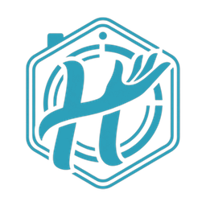

# PhysicalShortCut

<p align="center"></p>

Transforme **un événement physique** (un geste de la main, un claquement, une phrase, une empreinte,
un branchement USB, une secousse, un capteur de gaz…) en **action** sur ton ordinateur. Ex-HandShortCut :
voir [RENAMING.md](RENAMING.md). Les gestes de la main (webcam, en tâche de fond) déclenchent des
actions personnalisées : lancer une application, la placer sur tel écran, envoyer un
raccourci clavier, piloter le volume, ouvrir une URL, appeler une API, exécuter une
commande... Le tout configurable depuis une interface web locale, **sans écrire une
ligne de code**.

**Windows** et **Linux** (X11 et Wayland), Python 3.10 – 3.12 ou exécutable natif sans Python.

```
Webcam --> MediaPipe (points de la main) --> comparaison aux gestes enregistrés
                                                        |
                                                        v
                                          geste reconnu -> action liée
```

- Un **geste** est une **pose enregistrée**, un **mouvement**, des **doigts levés**, un **comptage** de doigts
  ou un **dessin dans l'air** ; à une ou **deux mains**, avec des **conditions système** en plus.
- Un déclencheur peut aussi être un **son** (claquements), une **phrase** (voix hors ligne), une **empreinte**,
  un **branchement** (USB, Bluetooth, secteur, capot, Wi-Fi) ou un **capteur** à seuil (lumière, secousse,
  températures, Arduino/ESP32…). Ce que ta machine possède vraiment : [docs/CAPTEURS.md](docs/CAPTEURS.md).
- Une **action** est un **workflow** : un graphe de noeuds reliés (branches, boucles, erreurs) où les
  données circulent d'un noeud à l'autre.
- Tout se pilote depuis **http://127.0.0.1:5678** (accessible uniquement depuis ta machine).
- `gestures.json` et `actions.json` sont **rechargés à chaud** (via l'interface ou à la main).

---

## Installation

L'application est compilée en **exécutable natif** (Nuitka) : aucun Python à installer.
Les paquets sont dans les [Releases](https://github.com/yo-le-zz/PhysicalShortCut/releases) ;
chaque release fournit un fichier `SHA256SUMS` pour vérifier les téléchargements.

### Fedora / RHEL (.rpm)

```bash
sudo dnf install ./physicalshortcut-2.1.0-1.x86_64.rpm
```

### Debian / Ubuntu (.deb)

```bash
sudo apt install ./physicalshortcut_2.1.0_amd64.deb
```

Dans les deux cas : service `systemd --user` activé (démarrage à la connexion), entrée
**PhysicalShortCut** dans le menu d'applications (avec son icône), commande `physicalshortcut`.

```bash
physicalshortcut --open        # ou : systemctl --user start physicalshortcut
physicalshortcut doctor        # vérifie caméra, outils manquants, session graphique
```

Désinstallation : `sudo dnf remove physicalshortcut` / `sudo apt remove physicalshortcut`.

### Windows (.msi ou .exe)

| Fichier | Usage |
|---|---|
| `PhysicalShortCut-2.1.0-x64.msi` | Paquet MSI : double-clic, déploiement en entreprise (GPO, Intune), `msiexec /i PhysicalShortCut-2.1.0-x64.msi /qn` |
| `PhysicalShortCut-Setup-2.1.0.exe` | Installateur classique (Inno Setup), options de démarrage automatique et raccourci bureau |

Avec le MSI, `AUTOSTART=1` active le démarrage avec Windows :
`msiexec /i PhysicalShortCut-2.1.0-x64.msi /qn AUTOSTART=1`. Aucune connexion internet n'est
nécessaire : l'exécutable est embarqué. Désinstallation : Paramètres > Applications.

### Avec uv (toutes plateformes, sans paquet)

```bash
uv tool install --python 3.12 .      # depuis le dossier du projet
physicalshortcut --open
```

Sous Linux, installe aussi `wmctrl` (ou `xdotool`), `libgl1`, `libglib2.0-0` ; recommandés :
`playerctl`, `xclip`/`wl-clipboard`, `libnotify`, `brightnessctl`. `physicalshortcut doctor`
indique ce qui manque pour chaque étape.

> **Python ≤ 3.12** : `mediapipe==0.10.14` n'a pas de wheel pour 3.13+ et les versions
> récentes ont supprimé l'API `mp.solutions` utilisée ici. uv télécharge la bonne version.

---

## Utilisation

```text
physicalshortcut [--port 5678] [--camera 0] [--data-dir DOSSIER] [--open] [-v]
physicalshortcut stop                 arrête l'instance en cours
physicalshortcut paths                dossiers de données / journaux / exemples
physicalshortcut doctor               diagnostic de l'environnement
physicalshortcut export [fichier]     exporte gestes + actions (JSON portable)
physicalshortcut import [--replace] fichier
physicalshortcut autostart on|off|status   démarrage à la connexion (XDG / registre Windows)
```

Variables d'environnement : `PHYSICALSHORTCUT_PORT`, `PHYSICALSHORTCUT_CAMERA`, `PHYSICALSHORTCUT_DATA_DIR`.

| | Linux | Windows |
|---|---|---|
| Données (`gestures.json`, `actions.json`) | `~/.local/share/physicalshortcut` | `%LOCALAPPDATA%\PhysicalShortCut` |
| Journal | `~/.local/state/physicalshortcut/log` | `%LOCALAPPDATA%\PhysicalShortCut\Logs` |

Les gestes enregistrés utilisent des coordonnées normalisées : un export fait sous
Windows s'importe sous Linux (et inversement), via l'interface (**Exporter** / **Importer**) ou en
ligne de commande. À l'import, le système d'origine est détecté et les **chemins, variables
d'environnement et programmes courants** sont convertis (`notepad` ↔ `gnome-text-editor`,
`C:\Users\moi\Docs` ↔ `~/Docs`…) ; les commandes non convertibles sont réservées à leur système
d'origine et un rapport détaille les changements.

### Créer et modifier un geste

1. **Nouveau geste** : choisis *pose statique* ou *séquence*, **Démarrer**, fais le geste devant la caméra, **Arrêter**.
2. Nomme le geste, règle la **sensibilité**, lie-le à une action, enregistre.
3. Tous les réglages restent **modifiables** ensuite (bouton d'édition de la carte) : nom, action,
   seuil, durée de tenue, pause après déclenchement, et même **ré-enregistrement** du modèle.

**Les durées sont exprimées en secondes et en millisecondes** (avec l'équivalent en images
à la cadence réelle de ta caméra). Exemple : *tenue 0,27 s (270 ms) ≈ 8 images à 29,8 images/s*.
Une jauge **en direct** montre la distance au geste et le seuil, pour régler sans deviner.

### Gestes : doigts, comptage, dessin, deux mains

| Type | Principe | Valeur transmise |
|---|---|---|
| Pose enregistrée / mouvement | comparée à ton enregistrement (1 ou 2 mains pour les poses) | – |
| Doigts levés | tu choisis levé / baissé / peu importe par doigt, pour 1 ou 2 mains | – |
| Compter les doigts | intervalle min–max, 1 main, 2 mains ou total | `{{ gesture.value }}` = nombre |
| Dessiner dans l'air | index levé = stylo ; chiffres 0-9, formes, tracés à toi | `{{ gesture.value }}` (chiffre) / `{{ gesture.label }}` |

Le dessin se reconnaît **en local** (rapide, hors ligne). Pour des dessins libres, configure une IA dans
**Activité & réglages** : toute API compatible OpenAI (Ollama par défaut sur `127.0.0.1:11434`). Tu
indiques le *nom* de la variable d'environnement qui contient la clé, jamais la clé elle-même.

**Conditions** : en plus du geste, exige par exemple *uptime ≥ 30 min*, *CPU < 70 %*, *température < 50 °C*
(ignorable si le capteur manque), *sur secteur*, *processus lancé*… Un geste bloqué le dit dans l'activité.

### Créer un workflow

Les noeuds sans lien entrant démarrent à la reconnaissance du geste. Tire d'un point coloré vers un autre
noeud pour les relier : `suite`, `vrai` / `faux` (Si), `pour chaque` / `terminé` (boucle), `erreur`.
Donne un **nom** à un noeud : sa sortie devient la variable `{{ nom }}` pour tous les noeuds suivants.

```text
Lire le fichier  (nom : contenu) ──►  Écrire le fichier  (contenu : {{ contenu | upper }})
Dessin « 7 »  ──►  Volume = {{ gesture.value * 10 }} %
```

Variables prêtes à l'emploi : `gesture.value`, `gesture.name`, `gesture.label`, `now.time`,
`system.cpu_percent`, `system.uptime_minutes`, `args`, `last`. Filtres : `upper`, `lower`, `trim`, `int`,
`round`, `split`, `join`, `json`, `regex`, `default`, `truncate`…

La page **Modèles** installe 20 workflows complets avec leurs gestes (volume au doigt, volume en dessinant
un chiffre, capture datée, résumé IA du presse-papiers…).

### Créer une action (éditeur)

**Nouveau workflow** ouvre l'éditeur visuel : une palette par catégorie (recherche + icônes), le graphe,
un inspecteur à droite, un bouton de test qui affiche le résultat de chaque noeud. Chaque étape accepte aussi :

- `wait_ms` : attente après l'étape ;
- `only_on` : `windows` ou `linux` (une même action peut contenir des variantes par système) ;
- `enabled` : désactiver une étape sans la supprimer.

Les chemins acceptent `~`, `$VAR` et `%VAR%`. Les noms de touches sont normalisés
(`ctrl`, `control`, `win`, `super`, `cmd`... désignent la même touche).

### Étapes disponibles

Générée depuis le catalogue (`src/physicalshortcut/steps.py`), source unique de l'interface,
de la validation et de cette documentation.

<!-- steps:begin (genere par scripts/gen_docs.py, ne pas modifier a la main) -->

81 types d'étapes, regroupés en 9 catégories.

**Fenêtres & applications** : Lancer, placer et piloter les fenêtres

| Type | Rôle | Champs | Plateformes |
|---|---|---|---|
| `launch` | Démarre un programme, une commande du PATH ou une application installée. | `path`, `args`, `shell_cmd` | Windows + Linux |
| `open_path` | Ouvre un fichier ou un dossier avec l'application par défaut du système. | `path` | Windows + Linux |
| `move_window` | Déplace et redimensionne une fenêtre sur un écran (moitie, tiers, quart, plein écran...). | `title_contains`, `monitor`, `position` | Windows + Linux |
| `close_window` | Demande poliment la fermeture de la fenêtre. | `title_contains` | Windows + Linux |
| `focus_window` | Active la fenêtre et la place devant les autres. | `title_contains` | Windows + Linux |
| `minimize_window` | Réduit la fenêtre dans la barre des taches. | `title_contains` | Windows + Linux |
| `maximize_window` | Agrandit la fenêtre au maximum. | `title_contains` | Windows + Linux |
| `restore_window` | Rend à la fenêtre sa taille normale (annule agrandir / réduire). | `title_contains` | Windows + Linux |
| `wait_for_window` | Attend qu'une fenêtre apparaisse (utile après un lancement) avant de continuer. | `title_contains`, `timeout_ms` | Windows + Linux |
| `show_desktop` | Réduit ou restaure toutes les fenêtres pour montrer le bureau. | `mode` | Windows + Linux |
| `switch_desktop` | Passe au bureau virtuel suivant ou précédent (Linux : ou à un numéro précis). | `target`, `index` | Windows + Linux |
| `get_active_window` | Titre de la fenêtre au premier plan. | _aucun_ | Windows + Linux |

**Clavier & souris** : Simuler des touches, des clics et du texte

| Type | Rôle | Champs | Plateformes |
|---|---|---|---|
| `keypress` | Envoie une touche ou une combinaison. | `keys` | Windows + Linux |
| `type_text` | Tape un texte au clavier dans la fenêtre active (accents et symboles compris). | `text`, `interval_ms` | Windows + Linux |
| `mouse_move` | Place le curseur à une position de l'écran (en pixels). | `x`, `y` | Windows + Linux |
| `mouse_click` | Clique (à la position donnee, ou la ou se trouve le curseur). | `button`, `x`, `y` | Windows + Linux |
| `mouse_double_click` | Double-clique (à la position donnee, ou la ou se trouve le curseur). | `button`, `x`, `y` | Windows + Linux |
| `mouse_drag` | Maintient le bouton enfoncé de la position actuelle (ou de départ) jusqu'à la destination. | `x`, `y`, `from_x`, `from_y`, `button`, `duration_ms` | Windows + Linux |
| `mouse_scroll` | Fait défiler la fenêtre active. | `direction`, `amount` | Windows + Linux |
| `clipboard_set` | Place un texte dans le presse-papiers. | `text` | Windows + Linux |
| `clipboard_get_and_type` | Tape au clavier le contenu actuel du presse-papiers. | _aucun_ | Windows + Linux |
| `clipboard_get` | Récupère le texte du presse-papiers et le donne aux noeuds suivants. | _aucun_ | Windows + Linux |
| `get_cursor_position` | Coordonnées actuelles du curseur. | _aucun_ | Windows + Linux |

**Média & audio** : Lecture, volume, sons et voix

| Type | Rôle | Champs | Plateformes |
|---|---|---|---|
| `media_control` | Lecture / pause, piste suivante ou précédente, volume, muet. | `action` | Windows + Linux |
| `set_volume` | Définit le volume principal (0 à 100 %). | `level` | Windows + Linux |
| `play_sound` | Joue un fichier audio (WAV sur Windows ; WAV, OGG, MP3... sur Linux selon les lecteurs installés). | `path` | Windows + Linux |
| `speak` | Lit un texte à voix haute. | `text` | Windows + Linux |
| `get_volume` | Niveau du volume principal (0-100) et état muet. | _aucun_ | Windows + Linux |
| `get_media_state` | Lecture / pause / arrêt du lecteur actif, avec le titre, l'artiste et l'album. | _aucun_ | Windows + Linux |

**Web & réseau** : Pages web, API et WebSocket

| Type | Rôle | Champs | Plateformes |
|---|---|---|---|
| `open_url` | Ouvre une adresse dans le navigateur par défaut. | `url` | Windows + Linux |
| `http_request` | Envoie une requête HTTP (webhook, domotique, API...) et renvoie la réponse aux noeuds suivants. | `method`, `url`, `body`, `headers`, `timeout_s` | Windows + Linux |
| `websocket_send` | Ouvre une connexion WebSocket, envoie un message puis la referme. | `url`, `message` | Windows + Linux |

**Fichiers** : Écrire, copier, déplacer, capturer

| Type | Rôle | Champs | Plateformes |
|---|---|---|---|
| `file_write` | Crée ou remplace un fichier texte. | `path`, `content`, `append` | Windows + Linux |
| `file_read` | Lit un fichier texte et donne son contenu aux noeuds suivants (ex. Lire un fichier -> Écrire un fichier). | `path` | Windows + Linux |
| `file_delete` | Supprime définitivement un fichier. | `path` | Windows + Linux |
| `file_copy` | Copie un fichier (les métadonnées sont conservées). | `source`, `destination` | Windows + Linux |
| `file_move` | Déplace ou renomme un fichier ou un dossier. | `source`, `destination` | Windows + Linux |
| `directory_create` | Crée un dossier (et ses parents si besoin). | `path` | Windows + Linux |
| `screenshot` | Enregistre une capture de l'écran dans un fichier PNG. | `path` | Windows + Linux |

**Système** : Commandes, processus, affichage, alimentation

| Type | Rôle | Champs | Plateformes |
|---|---|---|---|
| `run_shell` | Exécute une commande dans le shell (en arrière-plan, ou en attendant sa fin pour récupérer sa sortie). | `cmd`, `capture`, `timeout_s` | Windows + Linux |
| `kill_process` | Arrête les processus dont le nom contient le texte donne (jamais PhysicalShortCut lui-même). | `name` | Windows + Linux |
| `notify` | Affiche une notification système. | `title`, `message` | Windows + Linux |
| `change_brightness` | Définit la luminosité de l'écran (0 à 100 %). | `level` | Windows + Linux |
| `change_wallpaper` | Applique une image comme fond d'écran. | `path` | Windows + Linux |
| `set_theme` | Bascule le thème du système entre clair et sombre. | `mode` | Windows + Linux |
| `power_action` | Verrouille, met en veille, ferme la session, redémarre ou éteint l'ordinateur. | `action` | Windows + Linux |
| `system_metric` | Lit l'uptime, l'usage ou la température du CPU, la RAM, la batterie... et la donne aux noeuds suivants. | `metric`, `arg` | Windows + Linux |
| `get_hostname` | Donne le hostname (nom réseau) de l'ordinateur aux noeuds suivants. | _aucun_ | Windows + Linux |
| `get_username` | Donne le nom de la session en cours. | _aucun_ | Windows + Linux |
| `get_os_info` | Système, version, architecture, nom de la machine et dossier personnel. | _aucun_ | Windows + Linux |
| `get_ip_address` | Adresse IP de l'ordinateur sur le réseau local (aucune requête n'est envoyée). | _aucun_ | Windows + Linux |
| `get_datetime` | Date, heure, jour de la semaine (1 = lundi) et horodatage, utilisables dans une condition ou un message. | _aucun_ | Windows + Linux |
| `get_screen_info` | Nombre d'écrans et résolution de l'écran principal. | _aucun_ | Windows + Linux |
| `get_env_var` | Valeur d'une variable d'environnement (vide si elle n'existe pas). | `name` | Windows + Linux |

**Données & variables** : Variables, extraction, journal : relier les noeuds entre eux

| Type | Rôle | Champs | Plateformes |
|---|---|---|---|
| `set_variable` | Calcule une valeur (texte, nombre, formule) et la range sous le nom du noeud. | `value`, `variable` | Windows + Linux |
| `log_message` | Écrit un message dans le journal et dans l'activité (utile pour vérifier ce que transporte un lien). | `message`, `level` | Windows + Linux |
| `parse_json` | Lit un texte JSON (ex. réponse d'une API) et extrait une valeur par son chemin. | `source`, `path` | Windows + Linux |
| `regex_extract` | Cherche un motif (expression régulière) dans un texte et renvoie la correspondance. | `source`, `pattern`, `group` | Windows + Linux |
| `random_number` | Tire un entier au hasard entre deux bornes (incluses). | `minimum`, `maximum` | Windows + Linux |

**IA & analyse** : Questions à une IA, analyse des mains

| Type | Rôle | Champs | Plateformes |
|---|---|---|---|
| `ai_ask` | Pose une question à une IA (Ollama, OpenAI, LM Studio...) avec, si tu veux, l'image de la caméra. | `prompt`, `with_image`, `system`, `model`, `base_url`, `timeout_s` | Windows + Linux |
| `hand_info` | Compte les doigts levés des mains visibles à cet instant. | _aucun_ | Windows + Linux |

**Logique & contrôle** : Attentes, conditions, boucles et sous-workflows

| Type | Rôle | Champs | Plateformes |
|---|---|---|---|
| `wait` | Attend un certain temps avant l'étape suivante. | `ms` | Windows + Linux |
| `if_window_exists` | Branche « Vrai » si une fenêtre est ouverte, « Faux » sinon (ou exécute un sous-workflow). | `title_contains`, `action_id`, `else_action_id` | Windows + Linux |
| `if_process_running` | Branche « Vrai » si un processus est actif, « Faux » sinon (ou exécute un sous-workflow). | `name`, `action_id`, `else_action_id` | Windows + Linux |
| `require_auth` | Demande l'empreinte (Linux : fprintd) ou Windows Hello, puis branche « Vrai » si c'est accepté, « Faux » sinon. | `timeout`, `action_id`, `else_action_id` | Windows + Linux |
| `repeat` | Exécute un autre workflow plusieurs fois de suite (variable loop.index). | `count`, `action_id`, `delay_ms` | Windows + Linux |
| `if_value` | Branche « Vrai » ou « Faux » selon une formule : comparaison, et/ou, valeurs des noeuds précédents. | `condition`, `action_id`, `else_action_id` | Windows + Linux |
| `if_system` | Branche « Vrai » ou « Faux » selon l'état de l'ordinateur : uptime, CPU, température, RAM, batterie, heure... | `metric`, `arg`, `op`, `value`, `on_unknown`, `action_id`, `else_action_id` | Windows + Linux |
| `for_each` | Répète les noeuds reliés au port « Pour chaque » pour chaque ligne ou élément d'une liste, puis continue sur « Terminé ». | `items`, `item_var`, `limit`, `action_id` | Windows + Linux |
| `run_action` | Exécute un autre workflow en lui passant des arguments (args.nom) et récupère son résultat. | `action_id`, `args` | Windows + Linux |
| `stop_workflow` | Termine immédiatement le workflow (toutes les branches). | `reason` | Windows + Linux |
| `if_compare` | Branche « Vrai » ou « Faux » : égal, différent, plus grand, contient, commence par, vide… | `left`, `cmp`, `right`, `ignore_case`, `action_id`, `else_action_id` | Windows + Linux |
| `switch` | Compare une valeur à jusqu'à 5 cas et suit la sortie correspondante ; « Autre cas » sinon. | `value`, `case1`, `case2`, `case3`, `case4`, `case5`, `ignore_case` | Windows + Linux |
| `if_random` | Branche « Vrai » avec une probabilité donnée (pile ou face, effet surprise…). | `percent` | Windows + Linux |
| `while_loop` | Répète les noeuds reliés à « Pour chaque » selon une condition réévaluée à chaque tour, puis continue sur « Terminé ». | `loop_mode`, `condition`, `max_iterations`, `delay_ms` | Windows + Linux |
| `for_range` | Répète les noeuds reliés à « Pour chaque » en comptant (variable i par défaut), puis continue sur « Terminé ». | `start`, `end`, `step`, `item_var`, `delay_ms` | Windows + Linux |
| `loop_forever` | Répète les noeuds reliés à « Pour chaque » N fois (variables loop.index, loop.last), puis continue sur « Terminé ». | `count`, `delay_ms` | Windows + Linux |
| `break_loop` | Interrompt la boucle en cours : on passe directement à « Terminé ». | _aucun_ | Windows + Linux |
| `continue_loop` | Abandonne le reste du tour en cours et passe au tour suivant de la boucle. | _aucun_ | Windows + Linux |
| `wait_until` | Attend qu'une condition devienne vraie (sortie « Vrai ») ou que le délai expire (sortie « Faux »). | `condition`, `metric`, `arg`, `op`, `value`, `timeout_s`, `interval_ms` | Windows + Linux |

<!-- steps:end -->

Un exemple complet est livré dans `src/physicalshortcut/examples/` (chemin affiché par
`physicalshortcut paths`). Le geste d'exemple est un gabarit vide : il faut l'enregistrer.

### Compatibilité Linux / Windows

- **Linux** : X11 complet ; Wayland partiel (fenêtres XWayland via `wmctrl`/`xdotool`, volume
  via `wpctl`/`pactl`, média via `playerctl`). `physicalshortcut doctor` liste les limites de ta session.
- **Windows** : fenêtres via `pygetwindow`, volume via `pycaw` (repli sur les touches média),
  luminosité, bureaux virtuels, synthèse vocale et thème via PowerShell.
- Les étapes propres à un système sont signalées dans le catalogue ; sur l'autre système elles
  sont ignorées proprement (journal) au lieu de planter l'action.

---

## Développement

```bash
uv sync                    # crée .venv (Python 3.12) avec les dépendances
uv run physicalshortcut -v     # lance l'application
uv run pytest              # tests
uv run ruff check src tests scripts
uv run python scripts/gen_docs.py   # régénère le tableau des étapes ci-dessus
```

Interface : CSS, icônes et polices sont **versionnés** (`webui/static`) ; Node n'est nécessaire
que pour les régénérer : `cd frontend && npm install && npm run build` (Tailwind CSS, icônes
[Lucide](https://lucide.dev) détectées automatiquement dans les templates, JS et le catalogue ;
le build échoue si une icône n'existe pas). Icônes de l'application : `python assets/make_icons.py`
régénère toutes les tailles à partir de `assets/logo.png`.

### Ajouter un type d'étape

1. `steps.py` : ajoute une `StepSpec` (catégorie, icône, champs, plateformes).
2. `action_executor.py` : écris `_step_<type>(step)` et ajoute-le à `_HANDLERS`.
3. `python scripts/gen_docs.py` pour mettre à jour la documentation.

Aucun JavaScript à modifier : l'éditeur se construit depuis le catalogue. Des tests vérifient
que catalogue, gestionnaires, icônes et README restent synchronisés.

### Construire les paquets

```bash
./build.sh            # Linux : détecte le système et les outils, compile (Nuitka), crée .deb/.rpm -> dist/
./build.sh --list     # montre ce qui est possible sans construire
./build.sh --docker   # compile dans Ubuntu 22.04 (binaire compatible avec davantage de distributions)
powershell -File packaging\windows\build.ps1       # Windows : .exe (Inno Setup 6) + .msi (WiX v5) -> dist\
```

La compilation prend 30 à 60 minutes la première fois. La CI fait tout cela automatiquement.

### Publier une version

1. Mets à jour `version` dans `pyproject.toml` et la section correspondante de `CHANGELOG.md`.
2. Crée et pousse le tag : `git tag v2.1.0 && git push origin v2.1.0`.

Le workflow `.github/workflows/release.yml` vérifie que le tag correspond à `pyproject.toml`,
construit `.deb`, `.rpm`, `.exe` et `.msi`, calcule `SHA256SUMS` et crée la release GitHub avec
les notes extraites du changelog. Détails : [docs/github-setup.md](docs/github-setup.md).

```
src/physicalshortcut/         cli, gesture_engine, steps (catalogue), action_executor, platform_utils,
                          schema, config_store, bundle, autostart, doctor, paths
src/physicalshortcut/webui/   Flask (app.py), templates, static (CSS, JS, icônes, polices)
frontend/                 sources Tailwind + génération du sprite d'icônes
assets/                   logo, icônes (make_icons.py)
packaging/                build_exe.py (Nuitka), linux (deb/rpm, systemd), windows (Inno Setup, WiX MSI)
scripts/                  gen_docs.py, release_notes.py
tests/                    pytest
```

### Capteurs : son, voix, empreinte, matériel

| Déclencheur | Ce qu'il détecte | Prérequis |
|---|---|---|
| Son | claquement simple / double / triple, bruit fort, silence | `pip install "physicalshortcut[audio]"`, micro autorisé |
| Voix | phrases dites (hors ligne), nombre dit | extra `audio` + modèle Vosk dans `<données>/models/` |
| Empreinte | doigt reconnu / inconnu | Linux : `fprintd` ; Windows : étape « Vérifier mon identité » |
| Branchement | USB, Bluetooth, secteur, capot, Wi-Fi | – |
| Capteur (seuil) | lumière, secousse, températures, ventilateur, inactivité, capteur externe | selon la machine |

Un PC n'a **ni capteur de gaz, ni thermomètre de pièce, ni détecteur de mouvement** : branche un Arduino/ESP32
(extra `serial`) et déclare-le dans *Activité → Capteurs externes*. Le **micro est désactivé par défaut** : il
ne s'ouvre que si tu l'autorises et qu'un geste Son/Voix existe. Détails : [docs/CAPTEURS.md](docs/CAPTEURS.md).

## Limites connues

- Capteurs : testés avec des données simulées, pas sur tous les matériels ; Windows Hello ne permet pas
  l'écoute continue de l'empreinte ; capot, accéléromètre et lumière dépendent de la machine.

- Détection des doigts et reconnaissance des dessins : seuils réglés sur des mains synthétiques, à affiner
  selon ta caméra ; carré et cercle peuvent se confondre (augmente la confiance minimale ou utilise l'IA).
- Reconnaissance de séquence : ré-échantillonnage + distance moyenne (pas de DTW) ; sensible à
  une vitesse très différente de l'enregistrement. En cas de faux négatifs, ré-enregistre 2-3 fois.
- Wayland pur : pas de contrôle des fenêtres natives ni d'injection de clavier sans `ydotool`.
- Une seule caméra à la fois (`--camera`).
- L'interface n'écoute que sur `127.0.0.1` ; ne l'expose jamais sur le réseau : elle peut lancer
  des commandes.

Licence : MIT. Créé par **yolezz**.
